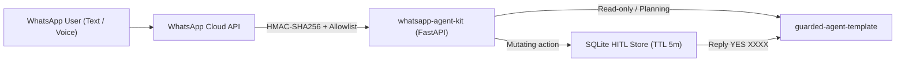

# whatsapp-agent-kit

[](https://github.com/moutaz121493/whatsapp-agent-kit/actions/workflows/ci.yml)
[](https://www.raspberrypi.com/)
[](LICENSE)

A secure, **ARM64-ready WhatsApp AI Agent template** with official **WhatsApp Cloud API** webhook verification (`X-Hub-Signature-256`), strict sender allowlisting, voice-note transcription intake, **Human-in-the-Loop (HITL)** approval gates (`YES <CODE>` / `NO <CODE>`), and a **built-in `/demo` web simulator** so you can test the entire flow locally in 30 seconds without Meta credentials.

Connects seamlessly with [`pi-n8n-ai-stack`](https://github.com/moutaz121493/pi-n8n-ai-stack) and [`guarded-agent-template`](https://github.com/moutaz121493/guarded-agent-template).

## Architecture



## 30-Second Local Demo (No Meta Account Needed)

```bash
git clone https://github.com/moutaz121493/whatsapp-agent-kit.git
cd whatsapp-agent-kit
cp .env.example .env
docker compose up -d --build
```

Open **`http://127.0.0.1:8082/demo`** in your browser to test:
- **Health Check** — read-only tool call returning live status.
- **Voice: Restart Worker (HITL)** — simulates a voice note → pauses with an ephemeral approval code → reply `YES <CODE>` to execute.
- **Prompt Injection Test** — blocked deterministically at `$0.00` cost.

## Real voice notes and replies

- With `GROQ_API_KEY` (or `STT_API_KEY` + `STT_BASE_URL` for any OpenAI-compatible speech-to-text), voice notes are
  transcribed for real with `whisper-large-v3-turbo`: WhatsApp media is downloaded from the Graph API with `WHATSAPP_TOKEN`.
  On the author's Raspberry Pi 5: **~0.4 s speech-to-text, ~1.2–1.4 s from voice note to answer** (English and Arabic).
- The `/demo` page has a **real voice-note** picker (any audio file) and, on https/localhost, a record button;
  it calls `POST /demo/voice` (`{sender, mime, audio_b64}`) → speech-to-text → agent.
- With `WHATSAPP_TOKEN` + `WHATSAPP_PHONE_NUMBER_ID`, answers are sent back to the sender via the Cloud API.
- `VOICE_REPLIES=1`: a voice note gets a **spoken answer** too (Orpheus TTS, English or Saudi Arabic voice chosen from the reply text); the text reply always goes first, so a TTS failure loses nothing.
  If a voice note can't be transcribed, the sender is told so instead of the agent guessing.

## Included n8n Workflow (`n8n/whatsapp-router.json`)

Import `n8n/whatsapp-router.json` into [`pi-n8n-ai-stack`](https://github.com/moutaz121493/pi-n8n-ai-stack) to orchestrate inbound WhatsApp webhooks visually alongside other automations.

## Security Defaults

- **Constant-time HMAC-SHA256 verification** on every `POST /webhook/whatsapp` payload.
- **Deny-by-default sender allowlist** (`WHATSAPP_ALLOWLIST`) — unknown phone numbers are rejected before touching the LLM.
- **Sender-bound HITL codes** with 5-minute expiry in SQLite — another user cannot approve your pending action.
- **Non-root container (`128m` RAM cap)** — safe to co-host on a 4 GB Raspberry Pi 5.

See [SECURITY.md](SECURITY.md) for the full threat model.
